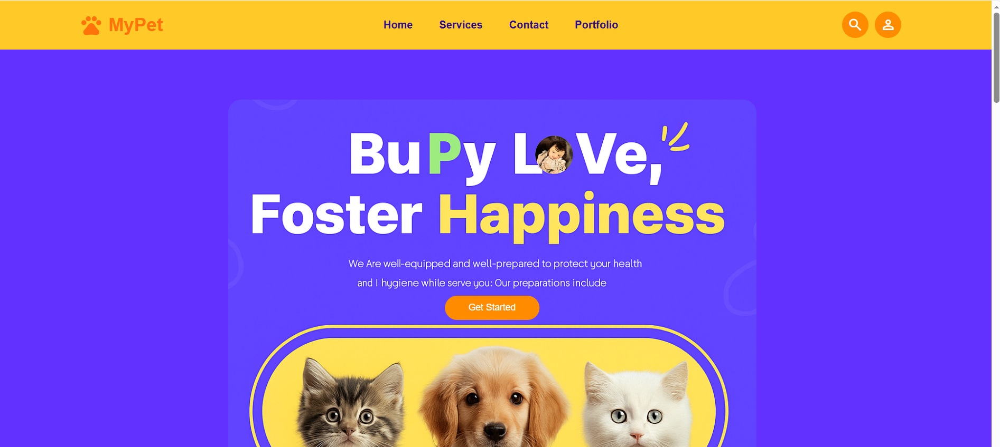
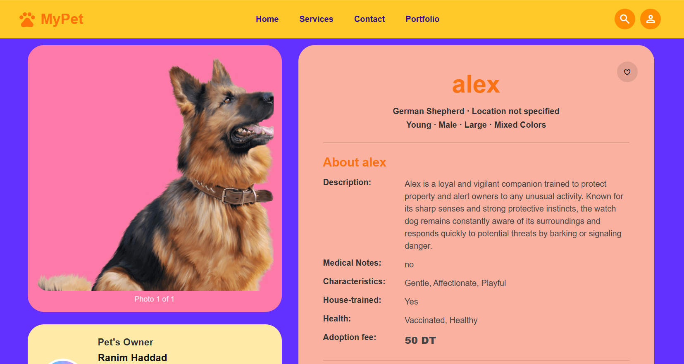
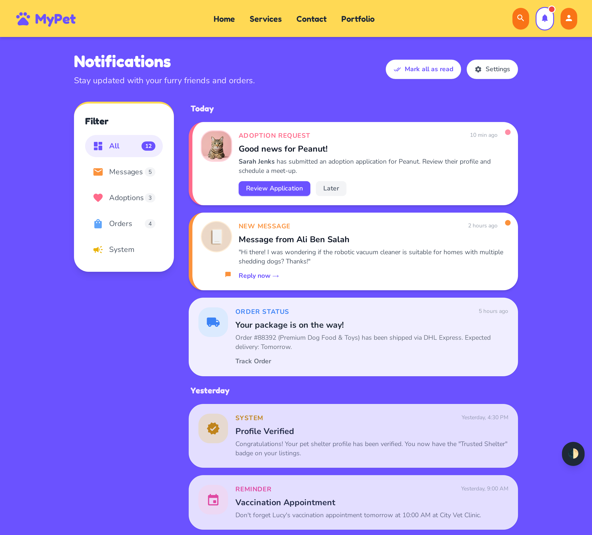

# MyPet — Pet Adoption Website

An Angular-based website designed to connect people with pets available for adoption.

## Technologies

- Angular
- TypeScript
- HTML
- CSS

## About

MyPet is an academic web development project focused on making pet adoption easier by providing a platform to explore pets and find adoption opportunities.

## Screenshots

### Home Page

### Pet Details

### Login

### Favorite pets listing

### User Notifications

